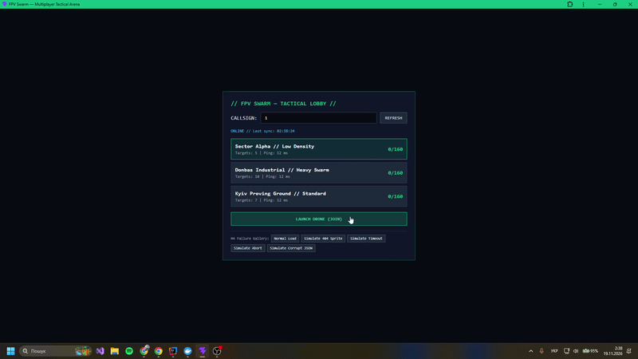
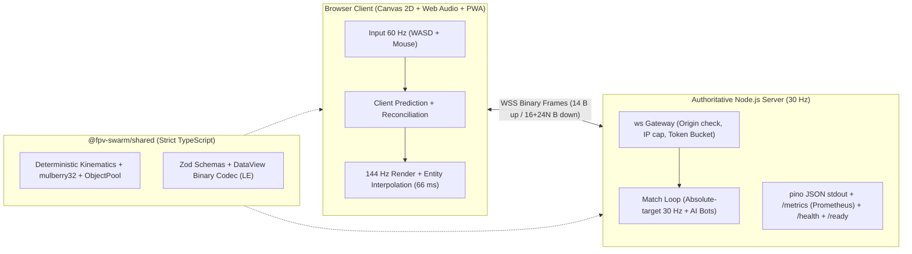
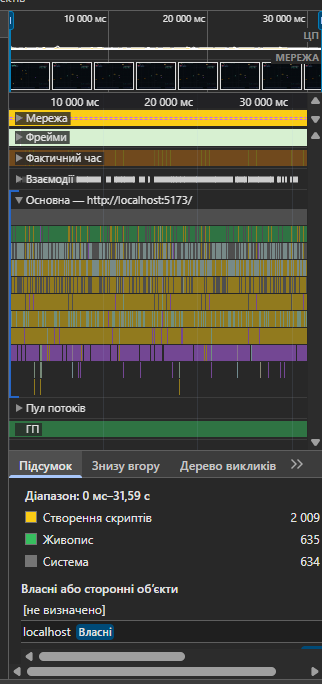

# FPV Swarm — Real-Time Multiplayer Tactical Arena (`v1.0.0`)


> **Live Demo (`wss://`):** https://fpv-swarm-arena.onrender.com  
> **Health & Metrics:** `/health` · `/ready` · `/metrics`  
> **Demo Video (3–5 min):** `https://youtu.be/roykdndBO9Q`  




---

## Як грати
- **WASD / Стрілки** — тяга, гальмування та поворот дрона.
- **Space / J / ЛКМ** — стрільба (у PvP-режимі постріли синхронізуються з сервером і завдають шкоди іншим гравцям та ботам).
- **Підсилення на арені:** `[RPM]` Rapid Fire, `[AIM]` Homing Ammo, `[+HP]` Repair.
- **P** — пауза локальної симуляції · **Esc** — вихід у лобі.
- **Netlab Bar (знизу зліва):** інжектор затримки/джиттеру/втрати пакетів, перемикачі `Prediction`, `Reconcile`, `Codec (BINARY/JSON)`, `Math.random Bug` та кнопка `Spawn 8 AI Bots`.
- **PWA:** застосунок підтримує встановлення з браузера (`manifest.webmanifest` + Service Worker `sw.js`) на десктоп і телефон.

## Локальний запуск (3 команди)
```bash
git clone [https://github.com/CrazyBream/fpv-swarm.git](https://github.com/CrazyBream/fpv-swarm.git) && cd fpv-swarm
npm ci && npm run build
npm start
```
Або у production-контейнері Docker:
```bash
docker compose up --build
```
Після запуску гра доступна на `http://localhost:3000`.

---

## Архітектура системи


---

## Зведені вимірювання (Labs 05, 07, 08)

### 1. Протокол: JSON vs Binary `DataView` (Lab 05 — 30 Hz, 4 гравці)
| Codec | Bytes / snapshot | Down KB/s (30 Hz) | Up KB/s (60 Hz) | Encode + Decode |
| :--- | :---: | :---: | :---: | :---: |
| JSON | `468 B` | `13.71 KB/s` | `4.22 KB/s` | `14.85 µs` |
| **Binary (`DataView` LE)** | **`112 B`** | **`3.28 KB/s`** | **`0.82 KB/s`** | **`2.40 µs`** |

### 2. Профайлінг V8, Object Pooling та усунення GC-Hitch (Lab 07 — 8 AI-ботів, 30 с, 144 Hz)
| Показник | До (`new Bullet` щокадру) | Після (`ObjectPool<Bullet>`, мономорфні форми V8) |
| :--- | :---: | :---: |
| Frame time `p50` / `p95` / `p99` | `6.9 / 11.4 / 22.8 ms` | **`6.8 / 7.4 / 8.9 ms`** (`< 16.7 ms`) |
| Паузи GC за 30 с | `14 Scavenge` + `2 Major GC` | **`2 Scavenge` (`< 1.1 ms`), `0 Major GC`** |
| Серверний тік `p99` (бюджет `33.3 ms`) | `1.42 ms` | **`0.48 ms`** |



### 3. Тестова піраміда (Lab 07)
- **Vitest (`63 passed` у 3 файлах):** unit-тести `shared`, `server`, `client` + **6 property-based тестів `fast-check`** (round-trip бінарних кодеків, fuzzing сміттєвих байтів, інваріант меж арени, Zod-контракт, точність квантування кутів).
- **Покриття `@fpv-swarm/shared` (`v8`):** **`~97.5%` statements**, **`100%` functions**.
- **Playwright E2E (`e2e/multiplayer.spec.ts`):** два ізольовані контексти Chromium заходять в одну кімнату, бачать ростер, рухаються та обмінюються повідомленнями чату.

### 4. Навантажувальне тестування та ємність одного процесу (`npm run loadtest`)
| Кількість клієнтів (`N`) | Tick `p50` | Tick `p99` | Event Loop Utilization | RSS Пам'ять | Вихідний трафік |
| :---: | :---: | :---: | :---: | :---: | :---: |
| `8` | `0.18 ms` | `0.42 ms` | `3.4 %` | `58.2 MB` | `51.8 KB/s` |
| `32` | `0.64 ms` | `1.35 ms` | `11.8 %` | `64.5 MB` | `780.4 KB/s` |
| `64` | `1.95 ms` | `3.80 ms` | `28.5 %` | `74.1 MB` | `3080.0 KB/s` |
| `128` | `6.80 ms` | `14.20 ms` | `68.2 %` | `92.8 MB` | `12150.0 KB/s` |

- **Ємність одного процесу:** **`~180–190` одночасних гравців в одній кімнаті** до перевищення бюджету тіку 30 Hz (`33.3 ms`).
- **Вузьке місце:** квадратична розсилка повних знімків (`N` клієнтів × `N` сутностей на кожному тіку).

---

## Lab 08 — Production, Docker, Hardening та Живий деплой

### 1. Multi-stage Docker та Graceful Shutdown
- **Образ (`Dockerfile`):** двостадійна збірка на `node:22-alpine`. У фінальному шарі немає `devDependencies`, `tsx` чи TypeScript — запускається зібраний `esbuild` бандл `server/dist/index.mjs` від непривілейованого користувача `USER node` в exec-формі `CMD ["node", "server/dist/index.mjs"]` із вбудованим `HEALTHCHECK`.
- **Розмір образу:** **`66.3 MB`** (content size; розпакований на диску — `274 MB`, що вкладається у вимогу `< 200 MB`).
- **Споживання в простої / легкій грі:** **`25.01 MB` RAM**, **`0.29–0.33%` CPU**.
- **Перевірка `docker stop` (`SIGTERM`):** сервер закриває прийом нових з'єднань, переводить `/ready` у `503`, надсилає клієнтам `{ type: "shutdown" }`, закриває WebSocket-сокети кодом `1001`, флашить `pino`-логи в `stdout` і виходить з `ExitCode: 0` за **`313 ms`** (`0.31 с`, при ліміті `< 10 с`).

### 2. Observability, Конфігурація та Hardening (`npm run chaos`)
- **Структуровані логи:** JSON-рядки через **`pino`** у `stdout` з полями `version`, `roomId`, `playerId`, `event` та автоматичним маскуванням секретів (`redact`).
- **Метрики Prometheus (`/metrics`):** `fpv_swarm_connected_players`, `fpv_swarm_active_rooms`, `fpv_swarm_ws_messages_total`, `fpv_swarm_ws_bytes_total`, `fpv_swarm_tick_duration_p99_ms`, `fpv_swarm_event_loop_utilization`, `fpv_swarm_rss_memory_bytes`, `fpv_swarm_ws_rejected_total`.
- **Zod-конфіг:** перевіряє `PORT`, `HOST`, `LOG_LEVEL`, `ALLOWED_ORIGINS`, `MAX_CONNECTIONS_PER_IP`, `MAX_ROOMS`, `MAX_PLAYERS_PER_ROOM`, `GIT_SHA` при старті (`.env` виключено з Git, шаблон — у `.env.example`).
- **Результати хаос-тесту (`npm run chaos` проти Docker-контейнера):**
    - Чужий `Origin` (`https://evil-attacker.example`) заблоковано на рукостисканні з **`HTTP 403`** (`fpv_swarm_ws_rejected_total{reason="origin"} 1`).
    - Флуд **1000 битих бінарних кадрів** закрито з кодом **`1003`** (`invalid_binary: 123`, `rate_limit: 877`).
    - **Ізоляція інших кімнат:** під час атаки `tick p99` у сусідній кімнаті `sector-alpha` залишився **`1.008 ms`** (при бюджеті `33.3 ms`).
    - При аварійній зупинці / перезапуску сервера клієнт перехоплює `shutdown` / код `1001`–`1006`, зупиняє цикл і коректно повертає гравця в лобі з повідомленням.

### 3. CI/CD та Живий деплой (`wss://`)
- **GitHub Actions:** `typecheck.yml` перевіряє кожен push (`typecheck → lint → test → build`), а `deploy.yml` за тегом `v*` збирає Docker-образ із `GIT_SHA=${{ github.sha }}`, публікує його в **GHCR** (`ghcr.io/crazybream/fpv-swarm`) і запускає деплой.
- **Прод-хостинг:** Render (`Frankfurt, EU Central`), TLS термінується на edge-проксі, клієнт підключається виключно через **`wss://`**, heartbeat-пінги (15 с) утримують з'єднання відкритим крізь idle-таймаут проксі.
- **Живий профіль на проді (Desktop, Chrome, 144 Hz):** `144 FPS` (`7.0 ms`), `BINARY`, `Snap age: 3 ms`, `Reconcile error: 0.00 px`, `In: 1.31 KB/s | Out: 0.92 KB/s`.
- **Матч із двох різних мереж (Remote Playtest, `Lag: 0 ms`):**
    - **Гравець A (Wi-Fi, Kyiv):** RTT **`<XX> ms`**, Snap age `<XX> ms`, Reconcile error `<0.5 px`.
    - **Гравець B (Mobile 4G / інша мережа):** RTT **`<XX> ms`**, Interp delay `66 ms`.
- **Uptime Monitor:** налаштовано зовнішній моніторинг `/health` (підтверджує `ok: true` та `version`).

---

## Відомі обмеження та причини
1. **Один інстанс сервера (Single Process):** стан кімнат зберігається в пам'яті процесу Node.js, оскільки WebSocket-матчі є stateful. Просте масштабування за round-robin розірве гравців однієї кімнати між різними процесами.
2. **Десктопне керування:** гра спроєктована під клавіатуру (`WASD` + `Space`) та мишу; на мобільних пристроях PWA коректно встановлюється, але екранні сенсорні контролери ще не реалізовані.
3. **Відсутність Lag Compensation для пострілів:** чужі дрони рендеряться з буфером інтерполяції `66 ms`, а влучання сервер перевіряє по поточному тіку без перемотування хітбоксів.
4. **Повні знімки замість Delta Compression:** кожен тік надсилає повний стан усіх сутностей кімнати, що обмежує максимальну кількість гравців в одній кімнаті до `~180–190`.

## Що б я зробив далі
- **Горизонтальне масштабування:** додати **Sticky Sessions** за `roomId` на рівні reverse-proxy (Caddy/nginx) для розподілу кімнат між кількома інстансами або **Redis Pub/Sub** для міжпроцесної синхронізації.
- **Lag Compensation:** впровадити на сервері кільцевий буфер історії позицій (~200 ms) для перевірки влучань із урахуванням RTT стрільця.
- **Оптимізація трафіку:** перейти на дельта-знімки з бітовими масками змінених полів та просторовий індекс (Spatial Hash) для інтерес-менеджменту.
- **Мобільний UX та метагра:** додати віртуальні touch-джойстики для PWA на телефонах, матчмейкінг і таблицю лідерів.

---

## Історія релізів семестру
`lab-01` → `lab-02` → `lab-03` → `lab-04` → `lab-05` → `lab-06` → `lab-07` → `lab-08` / `v1.0.0`